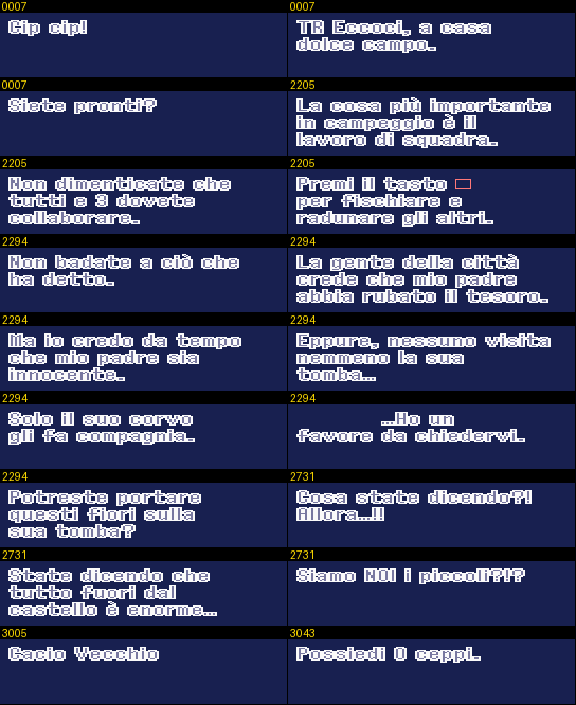

# Marvelous: Another Treasure Island — in italiano

Tre ragazzini in gita scolastica, un'isola piena di misteri, una maestra rapita dai pirati e un tesoro che nessuno è mai riuscito a trovare. Marvelous è uscito nel 1996 solo in Giappone, per un Super Famicom che stava già cedendo il passo al Nintendo 64. Lo ha diretto Eiji Aonuma, quello che poco dopo sarebbe passato a Zelda, e si vede: enigmi, dungeon, oggetti che si sbloccano piano piano. La differenza è che qui comandi tre personaggi insieme e per andare avanti devono collaborare.

Ora lo potete giocare anche in italiano.



## Per giocarci

Prendete `marvelous_ita.bps` dalla [pagina delle release](https://github.com/SancioPanza88/marvelous-ita/releases) e applicatelo alla ROM giapponese **pulita**, cioè senza nessun'altra patch sopra (niente patch inglese, ci pensa già questa):

| | |
|---|---|
| File | `Marvelous - Mouhitotsu no Takarajima (Japan).sfc` |
| Dimensione | 3.145.728 byte (senza header) |
| CRC32 | `CEDF3BA7` |
| SHA-1 | `46fe42f195d43b71ba0608356eb7c2b65bff70ac` |

La patch si applica con [Rom Patcher JS](https://www.marcrobledo.com/RomPatcher.js/), direttamente dal browser, oppure con [Floating IPS](https://www.romhacking.net/utilities/1040/). La ROM che ottenete pesa 4 MB, come quella della versione inglese. Se la vostra ROM ha l'header (un .smc da 3.146.240 byte), toglietelo prima.

La ROM non la trovate qui e non posso darvela.

## Cosa c'è dentro

Tutto il testo del gioco: 3076 voci tra dialoghi, cartelli, enigmi, nomi degli oggetti e menu di salvataggio. Al font ho aggiunto à è é ì ò ù. Le maiuscole accentate non c'erano e non c'era posto per disegnarle, quindi troverete E' al posto di È.

La patch parte dalla versione FastROM di Kandowontu, che è basata sulla traduzione inglese 1.07, quindi i miglioramenti di velocità ci sono anche qui.

Gli indovinelli coi numeri, quelli dove "1 è la coda di un cane" e via dicendo, li ho riscritti in modo che funzionino in italiano e abbiano ancora le stesse soluzioni. Se vi incastrate lì, non è colpa vostra: segnalatemelo.

Anche l'introduzione è in italiano: sia il racconto in corsivo sul Capitano Maverick, sia la parte a lettere grandi sul campeggio e sui pirati, che nel gioco sono immagini e non testo. Il corsivo l'ho ridisegnato con un carattere simile all'originale. Subito dopo il racconto compare la scritta "TRAD. ITA SANCIOPANZA88".

Sono rimasti in inglese il logo del titolo e le scritte disegnate nei menu ("New Game", "Team" e simili).

## Una cosa da sapere

Non ho fatto tutto da solo. Per questo progetto mi sono fatto aiutare da un'intelligenza artificiale (Claude, di Anthropic): con lei ho capito come il gioco memorizza il testo, ho scritto gli strumenti per estrarlo e reinserirlo e ho preparato la prima stesura della traduzione. Mi sembra giusto dirlo chiaramente.

Proprio per questo la v1.0 va presa per quello che è, cioè una versione da testare. Il testo è stato controllato in automatico: nessuna riga esce dalla finestra e i codici di ogni messaggio sono quelli originali. Il gioco però non l'ho ancora finito con la patch. Qualche frase storta, un refuso o un nome che cambia da un dialogo all'altro ci saranno di sicuro. Ho provato in emulatore l'introduzione, la schermata dei salvataggi e quella del nome della squadra. Il resto va giocato: le prime cose da guardare sono il menu di salvataggio durante la partita e la lista degli oggetti.

Se trovate un errore, aprite una [issue](https://github.com/SancioPanza88/marvelous-ita/issues) con uno screenshot e mi date una grossa mano. Se riuscite, aggiungete il numero della voce (tipo `### 2294`): lo trovate cercando la frase in `copione/copione_it.txt`.

## Per chi vuole mettere le mani nel copione

Gli script Python che ho usato sono in `strumenti/`. Serve Python 3, più Pillow per le anteprime. Si parte dalla ROM inglese FastROM (traduzione 1.07 + patch di Kandowontu) e dalla giapponese pulita:

```
python3 strumenti/compila_m.py ROM_INGLESE_FASTROM.sfc copione/copione_it.txt ROM_GIAPPONESE.sfc build
```

Nella cartella `build` trovate la ROM italiana e il file .bps. Gli script in `strumenti/grafica/` aggiungono l'introduzione tradotta (vanno sistemati i percorsi in cima ai file). Il copione è un normale file di testo con le regole scritte in cima: ogni riga deve stare nella finestra e i codici tra `< >` non vanno toccati. Se sbagliate, il compilatore ve lo dice. Per vedere com'esce una voce senza aprire l'emulatore:

```
python3 strumenti/anteprima_m.py build/ROM_ITA.sfc copione/copione_it.txt anteprima.png 2294 2731
```

## Grazie a

- **Tashi e DackR**: senza la loro traduzione inglese questa non esisterebbe. Il motore del testo con caratteri a larghezza variabile e la ROM espansa sono lavoro loro, io ci ho costruito sopra.
- **Kandowontu**, per la patch FastROM.
- **Nintendo** ed **Eiji Aonuma**, per aver fatto questo gioco.

Traduzione italiana di **Sanciopanza88**, 2026.

*Marvelous: Mōhitotsu no Takarajima © 1996 Nintendo. Traduzione amatoriale e gratuita, senza alcun legame con i detentori dei diritti.*
